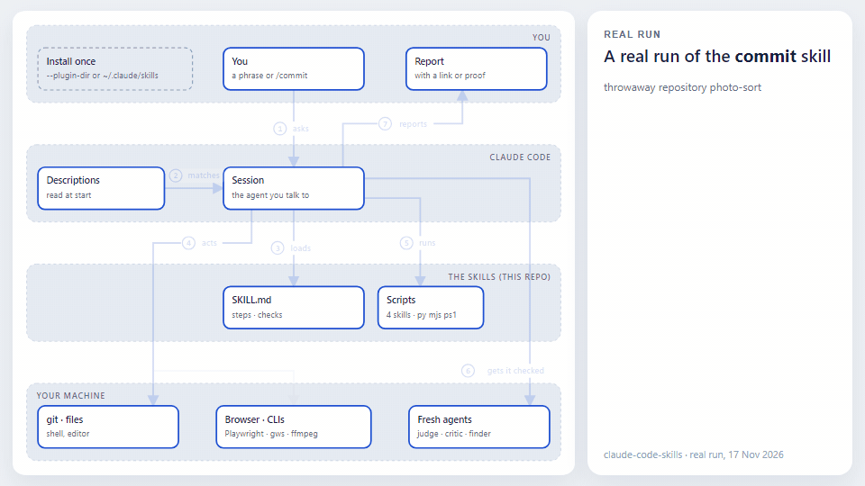
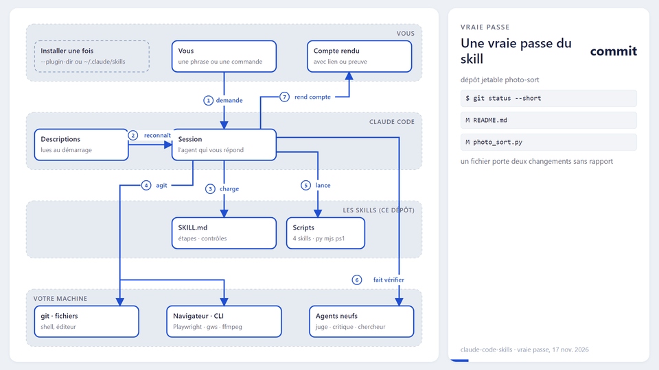

[English](README.md) · **Français**

# claude-code-skills

**35 méthodes de travail pour Claude Code, chacune un court texte (`SKILL.md`) que l'agent charge quand votre demande y correspond.**



<details><summary>Version française</summary>



</details>

*Une vraie passe de `commit` sur un dépôt jetable : un fichier portait deux changements, il a fait deux commits et vérifié l'envoi en 14 s.*

## Utilisation

- **Demander avec ses mots.** « commit ça », « attaque mon raisonnement », « source-moi des chiffres fiables », ou taper `/work-methods:<nom>`.
- **Se faire contredire.** `adverse` lance un agent dont le seul but est de casser votre plan, avant un long calcul ou une publication.
- **Rien ne part sans être vu.** `confirm-external-send` montre le mail ou le message exact et attend un oui explicite.
- **Un historique propre.** `commit` coupe des changements mêlés en commits atomiques et vérifie l'envoi, comme dans l'animation ci-dessus.
- **Des pages jugées sur l'image.** `harmony` et `streamline` regardent une capture du rendu, jamais le code.
- **Lire avant d'installer.** Chaque skill est surtout un fichier Markdown, en français pour l'essentiel ; quatre ont un petit script.

## Les skills

| Thème | Skills |
|---|---|
| Réfléchir et contredire | [`think`](skills/think/SKILL.md) · [`adverse`](skills/adverse/SKILL.md) · [`honest`](skills/honest/SKILL.md) · [`self-reflect`](skills/self-reflect/SKILL.md) · [`simple`](skills/simple/SKILL.md) · [`rattrapage`](skills/rattrapage/SKILL.md) · [`bullet-points`](skills/bullet-points/SKILL.md) |
| Vérifier | [`confirm-external-send`](skills/confirm-external-send/SKILL.md) · [`monitor`](skills/monitor/SKILL.md) · [`data-sourcing`](skills/data-sourcing/SKILL.md) · [`audit-loop`](skills/audit-loop/SKILL.md) · [`create-account-in-chrome`](skills/create-account-in-chrome/SKILL.md) |
| Livrer et concevoir | [`streamline`](skills/streamline/SKILL.md) · [`harmony`](skills/harmony/SKILL.md) · [`format-notion`](skills/format-notion/SKILL.md) · [`design-on-the-go`](skills/design-on-the-go/SKILL.md) · [`visuel-recherche`](skills/visuel-recherche/SKILL.md) · [`illustrate`](skills/illustrate/SKILL.md) · [`dashboard`](skills/dashboard/SKILL.md) · [`brainstorming-design`](skills/brainstorming-design/SKILL.md) |
| Organiser le travail | [`commit`](skills/commit/SKILL.md) · [`team-agents`](skills/team-agents/SKILL.md) · [`add-autonomous-task`](skills/add-autonomous-task/SKILL.md) · [`launch-autonomous-task`](skills/launch-autonomous-task/SKILL.md) · [`nightshift`](skills/nightshift/SKILL.md) · [`continue-conversation`](skills/continue-conversation/SKILL.md) |
| Documents, audio, agenda | [`analyse-reunion`](skills/analyse-reunion/SKILL.md) · [`transcribe-audio`](skills/transcribe-audio/SKILL.md) · [`drive-audio`](skills/drive-audio/SKILL.md) · [`sign-docx`](skills/sign-docx/SKILL.md) · [`collab-docx-edit`](skills/collab-docx-edit/SKILL.md) · [`note-agenda`](skills/note-agenda/SKILL.md) |
| Unity / Meta XR, disque | [`doc`](skills/doc/SKILL.md) · [`debug-xr`](skills/debug-xr/SKILL.md) · [`disk-clean`](skills/disk-clean/SKILL.md) |

<details><summary>Ce que fait chaque skill</summary>

| Skill | Ce qu'il fait |
|---|---|
| `think` | Un long cycle de réflexion sur un problème difficile : le cadrer, produire des options concurrentes, chercher en ligne, éliminer sur preuves, rendre une recommandation défendue. |
| `adverse` | Lance un agent dont le seul but est de casser votre raisonnement, votre plan ou vos chiffres, avant un long calcul, une publication, une décision irréversible. |
| `honest` | Mode vérité d'abord : vérifier avant d'affirmer, contester le fond, calibrer la certitude (je sais / je pense / je ne sais pas). |
| `self-reflect` | Débloque un agent qui tourne en rond : sous-agents neufs qui n'ont pas vu les essais ratés, recherche en ligne obligatoire, réparation durable de la cause. |
| `simple` | Expliquer les choses par ce qu'elles font plutôt que par leur nom ; l'exemple avant la règle. |
| `rattrapage` | Réexpliquer, sans contexte préalable, ce que l'utilisateur a manqué pendant que l'agent travaillait seul. |
| `bullet-points` | Un résumé en puces courtes, et rien d'autre. |
| `confirm-external-send` | Montrer le brouillon exact et obtenir un oui explicite avant que rien ne sorte de la machine (mail, message, formulaire) ; revérifier chaque fait cité. |
| `monitor` | Un fichier de surveillance vivant et une boucle vérifier–agir–replanifier pour un agent manager qui suit un travail de fond. |
| `data-sourcing` | Des chiffres avec preuve : agents chercheurs, juge adverse qui tente de réfuter chaque nombre, échelle de fiabilité. |
| `audit-loop` | Des agents qualité indépendants critiquent une appli web dans un vrai navigateur ; l'agent principal répare. |
| `create-account-in-chrome` | Jamais de compte créé dans le navigateur d'automatisation : ouvrir la page exacte dans le navigateur de l'utilisateur pour que son gestionnaire de mots de passe garde les identifiants. |
| `streamline` | Réduire une page, un document ou un parcours à l'essentiel, lui donner un rendu professionnel, compter les clics. |
| `harmony` | Corriger les défauts de mise en page (texte tronqué, chevauchements, mauvais alignements) en regardant une image du rendu, jamais le code. |
| `format-notion` | Un standard de mise en page à la Notion avec des encadrés colorés par sens (et la feuille de style prête à copier). |
| `design-on-the-go` | Itérer sur un visuel par retours courts et sans question : deviner, construire, annoncer en deux lignes, rafraîchir. |
| `visuel-recherche` | Un tournoi visuel évolutif (challenger contre champion) guidé par une théorie écrite de ce qui rend le visuel bon. |
| `illustrate` | Poser une vraie image du web (capture de presse, recherche d'images) sur une diapo, jugée sur le rendu. |
| `dashboard` | Construire un tableau de bord web privé en un fichier, au style Notion (`assets/notion.css`), servi en local. |
| `brainstorming-design` | Transformer une idée floue en conception : une question à la fois, 2 ou 3 approches, validation par sections. Dérivé du `brainstorming` de superpowers (MIT). |
| `commit` | Commits atomiques (une intention chacun), titres lisibles dans `git log --oneline`, corps qui dit pourquoi, envoi vérifié. |
| `team-agents` | Faire travailler des équipes d'agents en parallèle : tâches avec dépendances, consignes autonomes, suivi, arrêt. |
| `add-autonomous-task` / `launch-autonomous-task` | Fixer une tâche autonome maintenant (objectif, critères de succès vérifiables), la lancer plus tard sous une boucle `monitor` qui s'arrête seule. |
| `nightshift` | (Windows) Les tâches de nuit s'inscrivent dans un registre commun ; la dernière à finir éteint la machine. |
| `continue-conversation` | Retrouver et reprendre une conversation Claude Code qui a planté (cherche dans `~/.claude*/projects`, et sur d'autres machines par SSH). |
| `analyse-reunion` | Une transcription de réunion devient une analyse structurée (synthèse, décisions, actions, points en suspens), sans rien inventer. |
| `transcribe-audio` | Audio ou vidéo vers texte avec faster-whisper (local) ou l'API Groq Whisper ; synthèse multi-agents en option, avec contrôle anti-invention. |
| `drive-audio` | Récupérer le ou les derniers audios de Google Drive et les transcrire. |
| `sign-docx` | (Windows + Word) L'humain voit le document avant de signer, puis export en PDF. |
| `collab-docx-edit` | Modifier un document Drive que l'utilisateur modifie aussi : télécharger la version vivante, corriger sur place, renvoyer. |
| `note-agenda` | Ajouter une ligne à l'événement « À faire » d'un jour dans Google Agenda. |
| `doc` | Chercher dans la documentation officielle Meta Horizon (index local du `llms.txt` du site) avant de câbler quoi que ce soit. |
| `debug-xr` | Une boucle de débogage XR dans Unity : la doc d'abord, comparer au prefab de référence du SDK, sonde persistante, un essai qui tranche. |
| `disk-clean` | Faire le point sur l'espace disque et nettoyer des lots autorisés en protégeant les projets actifs ; avec un script d'inventaire en lecture seule. |

</details>

## Architecture


<details><summary>Diagramme en français</summary>


</details>

## Installation

```bash
git clone https://github.com/anthohunt/claude-code-skills.git
# en plugin : /work-methods:<nom>
claude --plugin-dir ./claude-code-skills
# ou copier un seul skill : /commit
mkdir -p ~/.claude/skills && cp -r claude-code-skills/skills/commit ~/.claude/skills/
```

<details><summary>Prérequis, test</summary>

- **Rien d'autre que Claude Code** pour la plupart des skills.
- **[`gws`](https://github.com/googleworkspace/cli)** (Google Workspace en ligne de commande, connecté) : `note-agenda`, `drive-audio`, `collab-docx-edit` (avec `python-docx`).
- **`ffmpeg`** et soit `faster-whisper` (carte NVIDIA en option), soit une `GROQ_API_KEY` : `transcribe-audio`.
- **Un outil navigateur Playwright** : `illustrate`, `audit-loop` ; `puppeteer` pour `visuel-recherche`.
- **Windows seulement** (PowerShell) : `nightshift`, `sign-docx` (avec Word).
- **Test.** `python3 tests/verifier_skills.py` contrôle chaque en-tête et cherche les chemins ou adresses personnels.

</details>

## État

- **Publié le 26/10/2026.** Copie du dépôt privé de skills de l'auteur, sans chemins ni adresses personnels ; pas mise à jour depuis, alors que les versions privées ont continué d'évoluer.
- **En usage.** 24 des 35 sont toujours dans le jeu de l'auteur, synchronisé sur chaque machine et chaque compte Claude ; les 11 autres en ont été retirés le 27/10/2026 après 60 jours sans être lancés.
- **Ailleurs.** `mission` est dans [mission-loop](https://github.com/anthohunt/mission-loop), les skills d'auto-recherche dans [la-boucle-methode](https://github.com/anthohunt/la-boucle-methode). Les skills d'autres auteurs ne sont pas redistribués : [Anthropic](https://github.com/anthropics/skills), [obra/superpowers](https://github.com/obra/superpowers), [addyosmani/agent-skills](https://github.com/addyosmani/agent-skills), [academic-research-skills](https://github.com/Imbad0202/academic-research-skills) (CC BY-NC).
- **Licences.** Scripts sous [Apache 2.0](LICENSE) ([NOTICE](NOTICE)) ; textes des skills et `notion.css` sous [CC BY 4.0](LICENSE-docs) ; `brainstorming-design` dérive d'obra/superpowers (MIT, `skills/brainstorming-design/LICENSE-superpowers-MIT`).

---

**Anthony Hunt** · [ingevision.cloud](https://ingevision.cloud/?p=outils-claude-code) · [LinkedIn](https://www.linkedin.com/in/anthony-hunt-3948a9196) · [GitHub](https://github.com/anthohunt)
