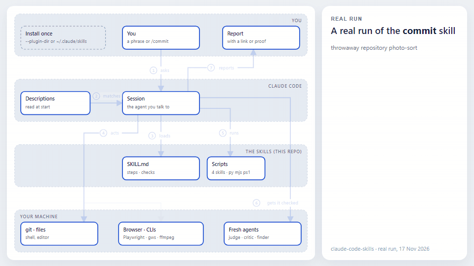
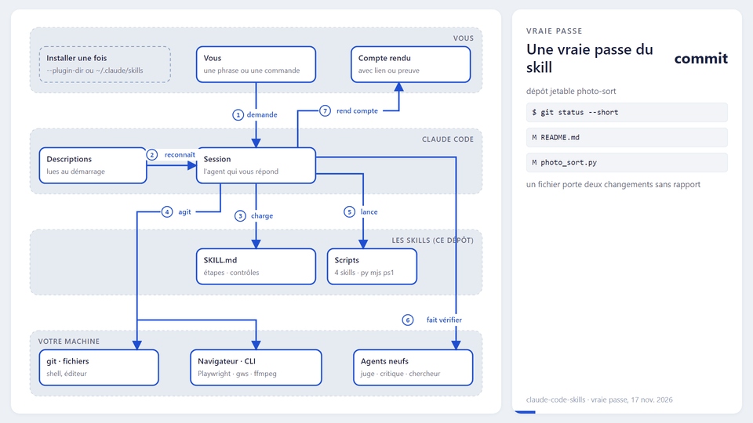

**English** · [Français](README.fr.md)

# claude-code-skills

**35 working methods for Claude Code, each one a short text (`SKILL.md`) that the agent loads when your request matches it.**



<details><summary>French version</summary>



</details>

*A real run of `commit` on a throwaway repository: one file held two changes, it made two commits and checked the push in 14 s; commit messages in French.*

## Using it

- **Ask in your own words.** "commit ça", "attaque mon raisonnement", "source-moi des chiffres fiables", or type `/work-methods:<name>`.
- **Get challenged.** `adverse` starts an agent whose only job is to break your plan, before a long computation or a publication.
- **Nothing leaves unseen.** `confirm-external-send` shows the exact mail or message and waits for an explicit yes.
- **Clean history.** `commit` splits mixed changes into atomic commits and checks the push, as in the animation above.
- **Pages judged on the image.** `harmony` and `streamline` look at a rendered capture, never at the code.
- **Read before installing.** Each skill is mainly one Markdown file, mostly in French; four come with a small script.

## The skills

| Theme | Skills |
|---|---|
| Think and challenge | [`think`](skills/think/SKILL.md) · [`adverse`](skills/adverse/SKILL.md) · [`honest`](skills/honest/SKILL.md) · [`self-reflect`](skills/self-reflect/SKILL.md) · [`simple`](skills/simple/SKILL.md) · [`rattrapage`](skills/rattrapage/SKILL.md) · [`bullet-points`](skills/bullet-points/SKILL.md) |
| Check | [`confirm-external-send`](skills/confirm-external-send/SKILL.md) · [`monitor`](skills/monitor/SKILL.md) · [`data-sourcing`](skills/data-sourcing/SKILL.md) · [`audit-loop`](skills/audit-loop/SKILL.md) · [`create-account-in-chrome`](skills/create-account-in-chrome/SKILL.md) |
| Deliver and design | [`streamline`](skills/streamline/SKILL.md) · [`harmony`](skills/harmony/SKILL.md) · [`format-notion`](skills/format-notion/SKILL.md) · [`design-on-the-go`](skills/design-on-the-go/SKILL.md) · [`visuel-recherche`](skills/visuel-recherche/SKILL.md) · [`illustrate`](skills/illustrate/SKILL.md) · [`dashboard`](skills/dashboard/SKILL.md) · [`brainstorming-design`](skills/brainstorming-design/SKILL.md) |
| Organise the work | [`commit`](skills/commit/SKILL.md) · [`team-agents`](skills/team-agents/SKILL.md) · [`add-autonomous-task`](skills/add-autonomous-task/SKILL.md) · [`launch-autonomous-task`](skills/launch-autonomous-task/SKILL.md) · [`nightshift`](skills/nightshift/SKILL.md) · [`continue-conversation`](skills/continue-conversation/SKILL.md) |
| Documents, audio, calendar | [`analyse-reunion`](skills/analyse-reunion/SKILL.md) · [`transcribe-audio`](skills/transcribe-audio/SKILL.md) · [`drive-audio`](skills/drive-audio/SKILL.md) · [`sign-docx`](skills/sign-docx/SKILL.md) · [`collab-docx-edit`](skills/collab-docx-edit/SKILL.md) · [`note-agenda`](skills/note-agenda/SKILL.md) |
| Unity / Meta XR, disk | [`doc`](skills/doc/SKILL.md) · [`debug-xr`](skills/debug-xr/SKILL.md) · [`disk-clean`](skills/disk-clean/SKILL.md) |

<details><summary>What each skill does</summary>

| Skill | What it does |
|---|---|
| `think` | A long reflection cycle for a hard problem: frame it, produce competing options, search the web, eliminate by evidence, return one defended recommendation. |
| `adverse` | Launches an agent whose only goal is to break your reasoning, plan or numbers, before a long computation, a publication, an irreversible decision. |
| `honest` | Truth-first mode: verify before asserting, challenge the substance, calibrate certainty (know / think / don't know). |
| `self-reflect` | Unblocks an agent that loops: fresh sub-agents that never saw the failed attempts, a mandatory web search, a permanent repair of the root cause. |
| `simple` | Explain by what things do rather than by their names; the example comes before the rule. |
| `rattrapage` | Re-explain, standalone, something the user missed while the agent was working alone. |
| `bullet-points` | A summary as concise bullets and nothing else. |
| `confirm-external-send` | Show the exact draft and get an explicit yes before anything leaves the machine (mail, message, form); re-check every quoted fact. |
| `monitor` | A living watch-list file plus a check–act–reschedule loop for a manager agent following background work. |
| `data-sourcing` | Figures with proof: finder agents, an adversarial judge that tries to refute each number, a reliability scale. |
| `audit-loop` | Independent quality agents criticise a web app through a real browser; the main agent repairs. |
| `create-account-in-chrome` | Never create accounts in the automation browser: open the exact page in the user's own browser so the password manager keeps the credentials. |
| `streamline` | Cut a page, document or flow to its signal, make it look professional, count the clicks. |
| `harmony` | Fix layout defects (truncated text, overlaps, misalignment) by looking at a rendered image, never at the code. |
| `format-notion` | A Notion-like layout standard with semantic callout colours (and ready-to-copy CSS). |
| `design-on-the-go` | Iterate on a visual with short feedback and no questions: guess, build, announce in two lines, refresh. |
| `visuel-recherche` | An evolutionary visual tournament (challenger vs champion) driven by a written theory of what makes it good. |
| `illustrate` | Put a real web image (press screenshot, image search) on a slide, judged on the rendered result. |
| `dashboard` | Build a private one-file web dashboard in a Notion look (`assets/notion.css`), served locally. |
| `brainstorming-design` | Turn a rough idea into a design: one question at a time, 2–3 approaches, sectioned validation. Derived from superpowers' `brainstorming` (MIT). |
| `commit` | Atomic commits (one intention each), titles that read well in `git log --oneline`, bodies that say why, push verified. |
| `team-agents` | Run parallel agent teams: tasks with dependencies, self-contained prompts, monitoring, shutdown. |
| `add-autonomous-task` / `launch-autonomous-task` | Fix an autonomous task now (goal, verifiable success criteria), launch it later under a `monitor` loop that stops by itself. |
| `nightshift` | (Windows) Overnight tasks register in a shared registry; the last one to finish powers the machine off. |
| `continue-conversation` | Find and resume a Claude Code conversation that crashed (searches `~/.claude*/projects`, optionally other machines over SSH). |
| `analyse-reunion` | A meeting transcript becomes one structured analysis (summary, decisions, actions, open points), nothing invented. |
| `transcribe-audio` | Audio or video to text with faster-whisper (local) or the Groq Whisper API; optional multi-agent synthesis with an anti-fabrication check. |
| `drive-audio` | Fetch the latest audio file(s) from Google Drive and transcribe them. |
| `sign-docx` | (Windows + Word) The human sees the document before signing, then PDF export. |
| `collab-docx-edit` | Edit a Drive document the user is also editing: download the live version, patch in place, upload back. |
| `note-agenda` | Add one line to a per-day all-day "À faire" event in Google Calendar. |
| `doc` | Search the official Meta Horizon documentation (local index of the site's `llms.txt`) before wiring anything. |
| `debug-xr` | A debugging loop for XR behaviour in Unity: docs first, compare with the SDK's reference prefab, persistent probe, one discriminating run. |
| `disk-clean` | Audit disk space and clean authorised batches, protecting active projects; includes a read-only inventory script. |

</details>

## Architecture


<details><summary>French version</summary>


</details>

## Install

```bash
git clone https://github.com/anthohunt/claude-code-skills.git
# as a plugin: /work-methods:<name>
claude --plugin-dir ./claude-code-skills
# or copy one skill: /commit
mkdir -p ~/.claude/skills && cp -r claude-code-skills/skills/commit ~/.claude/skills/
```

<details><summary>Requirements, test</summary>

- **Nothing but Claude Code** for most skills.
- **[`gws`](https://github.com/googleworkspace/cli)** (Google Workspace CLI, logged in): `note-agenda`, `drive-audio`, `collab-docx-edit` (plus `python-docx`).
- **`ffmpeg`** and either `faster-whisper` (NVIDIA GPU optional) or a `GROQ_API_KEY`: `transcribe-audio`.
- **A Playwright browser tool**: `illustrate`, `audit-loop`; `puppeteer` for `visuel-recherche`.
- **Windows only** (PowerShell): `nightshift`, `sign-docx` (with Word).
- **Test.** `python3 tests/verifier_skills.py` checks every front matter and looks for personal paths or addresses.

</details>

## Status

- **Published 26 Oct 2026.** A copy of the author's private skills repository, with personal paths and addresses removed; not updated since, while the private versions kept changing.
- **In use.** 24 of the 35 are still in the author's own set, synced to every machine and Claude account; the 11 others were retired on 27 Oct 2026 after 60 days without a run.
- **Not here.** `mission` lives in [mission-loop](https://github.com/anthohunt/mission-loop), the auto-research skills in [la-boucle-methode](https://github.com/anthohunt/la-boucle-methode). Skills by other authors are not redistributed: [Anthropic](https://github.com/anthropics/skills), [obra/superpowers](https://github.com/obra/superpowers), [addyosmani/agent-skills](https://github.com/addyosmani/agent-skills), [academic-research-skills](https://github.com/Imbad0202/academic-research-skills) (CC BY-NC).
- **Licences.** Scripts under [Apache 2.0](LICENSE) ([NOTICE](NOTICE)); skill texts and `notion.css` under [CC BY 4.0](LICENSE-docs); `brainstorming-design` derives from obra/superpowers (MIT, `skills/brainstorming-design/LICENSE-superpowers-MIT`).

---

**Anthony Hunt** · [ingevision.cloud](https://ingevision.cloud/?lang=en&p=outils-claude-code) · [LinkedIn](https://www.linkedin.com/in/anthony-hunt-3948a9196) · [GitHub](https://github.com/anthohunt)
